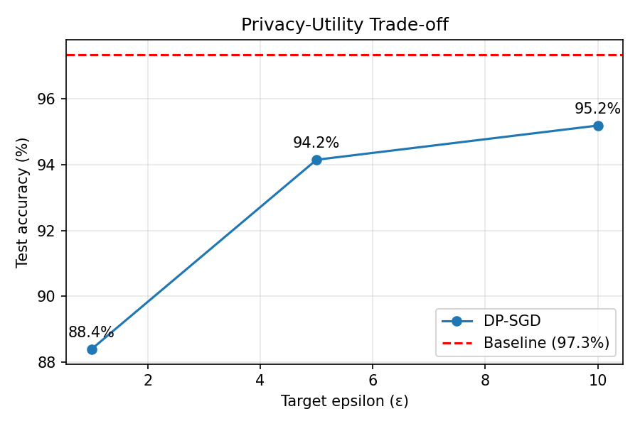
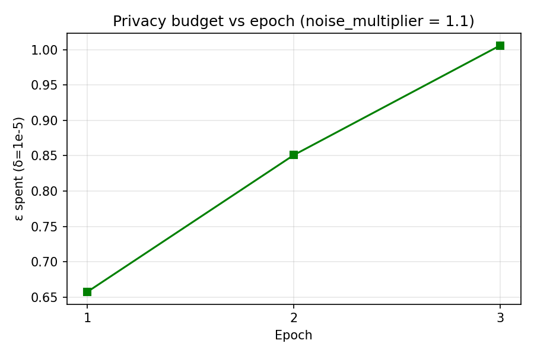

# 23AIML027 - External Practical

## Overview
This repository contains the implementation and evaluation results for an external practical focused on **[Differential Privacy / Adversarial Robustness]** in Machine Learning. The primary objective is to analyze the trade-offs between model accuracy and the privacy/perturbation budget ($\epsilon$) across training epochs.

## Repository Structure
* `23aiml027_External_prac.ipynb` — Jupyter Notebook containing data preprocessing, model training, evaluation, and plotting code.
* `accuracy_vs_epsilon.png` — Visualization illustrating how model accuracy changes across different $\epsilon$ values.
* `epsilon_vs_epoch.png` — Plot tracking the privacy budget ($\epsilon$) progression over training epochs.
* `README.md` — Project documentation.

## Results & Visualizations

### Accuracy vs. Epsilon

*Shows the impact of varying $\epsilon$ (privacy budget / perturbation strength) on overall model accuracy.*

### Epsilon vs. Epoch

*Tracks how the privacy loss ($\epsilon$) accumulates over consecutive training epochs.*

## Prerequisites & Setup

1. **Clone the repository:**
   ```bash
   git clone https://github.com
   cd 23AIML027_External_prac
   ```

2. **Install dependencies:**
   ```bash
   pip install numpy pandas matplotlib torch torchvision opacus jupyter
   ```
   *(Update the library list above based on whether you used PyTorch/Opacus, TensorFlow Privacy, or Scikit-learn.)*

3. **Run the Notebook:**
   ```bash
   jupyter notebook 23aiml027_External_prac.ipynb
   ```

## Key Details
* **Dataset:** [e.g., MNIST / CIFAR-10 / Custom Dataset]
* **Model Architecture:** [e.g., CNN / MLP / ResNet]
* **Technique Used:** [e.g., DP-SGD using Opacus / FGSM Adversarial Attack]
